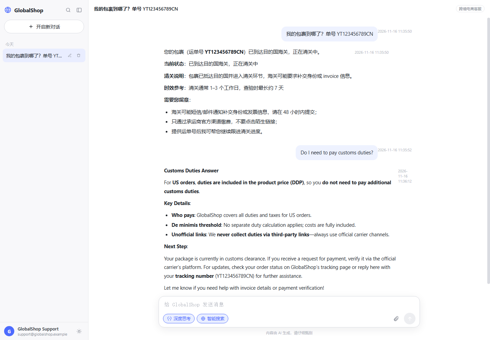
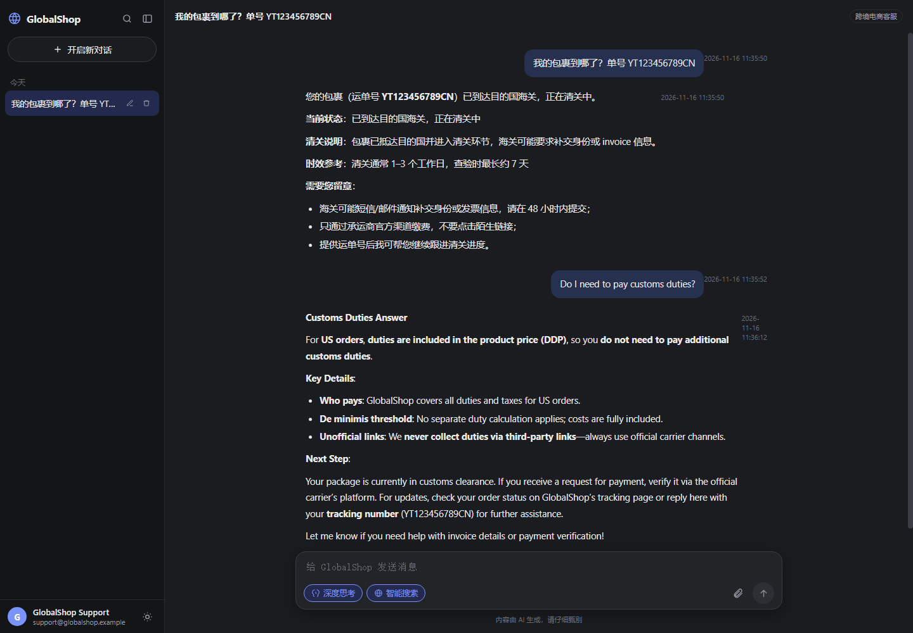
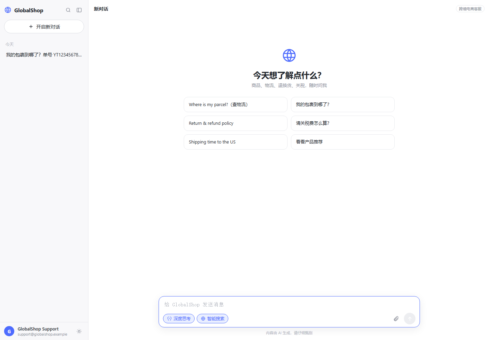
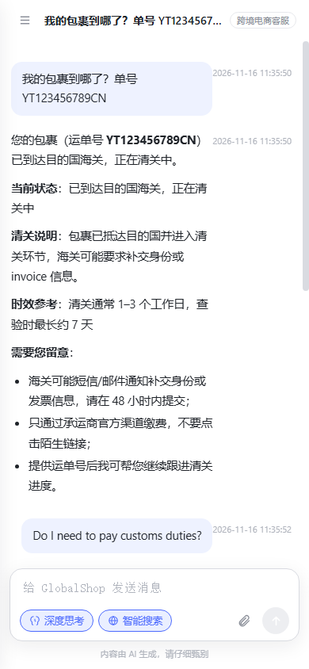
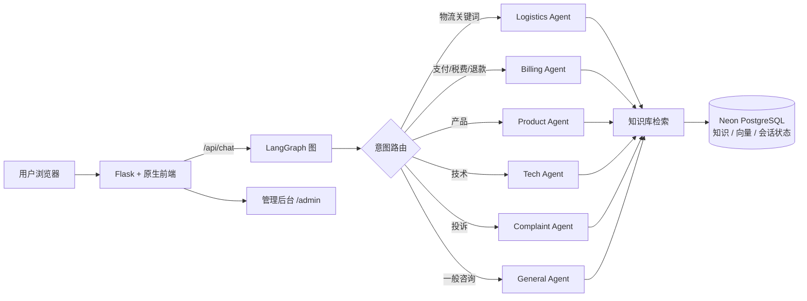

<div align="center">

# 🌍 GlobalShop AI 客服中心

**面向跨境电商的多智能体 AI 客服 · RAG 知识库 · 中英双语**

[](https://www.modelscope.cn/studios/huhuhummm/GlobalShop)
[](https://www.python.org/)
[](https://flask.palletsprojects.com/)
[](https://github.com/langchain-ai/langgraph)
[](https://neon.tech/)
[](https://www.docker.com/)
[](LICENSE)

</div>



## 📖 项目简介

**GlobalShop AI 客服中心**是一个面向跨境电商场景的智能客服系统：用户可以用中文或英文咨询商品、物流、退换货、关税等问题，系统自动识别**意图**与**语言**，路由到对应的专家智能体，并结合 **RAG 知识库**给出有依据的回答。

项目采用 **Multi-Agent（多智能体）架构**，基于 LangGraph 编排 6 个专家智能体，配合规则 + LLM 的混合路由；知识库通过 `BAAI/bge-m3` 向量化后存入 **Neon PostgreSQL**，检索结果作为事实依据注入提示词，显著降低大模型「编造政策」的概率。

> 在线体验：<https://www.modelscope.cn/studios/huhuhummm/GlobalShop>

## ✨ 核心亮点

| 能力 | 说明 |
|---|---|
| 🌐 **中英双语交互** | 自动识别提问语言，中文问中文答、英文问英文答，同一会话中切换语言也能跟随 |
| 📦 **物流状态查询** | 识别运单号（UPU S10 / 专线 / 纯数字），返回清关、派送状态与时效；**规则命中，不消耗模型额度** |
| ↩️ **退换货政策解答** | 30 天无理由、拆封电子产品例外、运费由谁承担、5–10 个工作日退款，全部来自知识库原文 |
| 💰 **关税问题自动回答** | 美国 DDP 含税、欧盟 VAT、de minimis 起征点等，按用户所在市场给出差异化说明 |
| 🔎 **RAG 知识库** | `bge-m3`（1024 维）向量检索 + 余弦相似度 Top-3，向量不可用时自动回退关键词检索 |
| 🧠 **多智能体编排** | 产品 / 技术 / 账单支付 / 投诉 / 综合 / 物流 六个专家，规则优先、模型兜底 |
| 💬 **DeepSeek 风格界面** | 侧栏会话分组、搜索、重命名、深色模式、思考过程折叠、会话级并发 |
| 🛠 **管理后台** | 会话查看、知识库增删与重建索引、模拟运单录入、索引状态 |

## 🖼 界面预览

### 对话（浅色）


### 对话（深色）


### 新建对话


### 移动端


## 🏗 系统架构



**一次请求的处理链路**：语言识别 → 规则路由（物流 / 税费）→ 向量检索 Top-3 → 专家智能体生成 → 返回并持久化会话状态。

## 🧰 技术栈

| 层 | 选型 |
|---|---|
| 语言 / 运行时 | Python 3.12、Gunicorn |
| Web 框架 | Flask 3.x + 原生 HTML/CSS/JS（无前端构建链） |
| 多智能体编排 | **LangGraph 1.x**（状态图、条件边、checkpointer） |
| 知识检索 | `BAAI/bge-m3`（1024 维）+ 余弦相似度；关键词检索兜底 |
| 数据存储 | **Neon PostgreSQL**（知识片段、向量、会话、运单）；本地可用 SQLite |
| 模型服务 | 任意 OpenAI 兼容接口（默认硅基流动 Qwen3-8B） |
| 部署 | Docker / ModelScope 创空间（端口 7860） |

## 🔀 智能体路由

| 用户问题示例 | 路由 | 处理方式 |
|---|---|---|
| `我的包裹到哪了？单号 YT123456789CN` | Logistics Tracking | 规则命中，直接返回状态 |
| `Do I need to pay customs duties?` | Billing & Payments | 检索关税政策 + 模型生成 |
| `What is your return policy?` | Billing / General | 引用知识库退换货章节 |
| `耳机连不上手机` | Technical Support | 保修政策 + 排查步骤 |
| `我要投诉物流太慢` | Complaint Resolution | 补偿阶梯 + 升级路径 |
| `写一首关于夏天的诗` | 护栏 | 双语礼貌拒答，引导回购物场景 |

## 🚀 本地运行

```bash
# 1. 安装依赖
python -m venv .venv
.venv\Scripts\activate          # Windows
pip install -r requirements.txt

# 2. 配置环境变量
copy .env.example .env
# 填写 OPENAI_API_KEY、DATABASE_URL（本地可用 sqlite:///./data/app.db）等

# 3. 启动（单进程 embedded 模式，无需额外服务）
python web_app.py
# → http://localhost:5000
```

也可以一键用 Docker 起 Postgres + Web：

```bash
docker compose up -d --build
docker compose run --rm web python scripts/ingest_kb.py --force
```

## ☁️ 在线部署（ModelScope 创空间）

1. 创建 **Docker** 类型的创空间（公开）
2. 推送代码到创空间仓库的 `master` 分支：
   ```bash
   git push ms HEAD:master
   ```
3. 在创空间「设置 → 环境变量」配置：

   | 变量 | 说明 |
   |---|---|
   | `DATABASE_URL` | Neon 连接串（`?sslmode=require`） |
   | `OPENAI_API_KEY` | 模型服务 Key |
   | `ADMIN_PASSWORD` | 后台密码 |
   | `FLASK_SECRET_KEY` | 会话签名密钥 |
   | `APP_MODE` | 固定为 `embedded` |

4. 容器监听 `0.0.0.0:7860`（镜像已内置），构建完成后即可访问

## 🛠 管理后台

`/admin` → 输入 `ADMIN_PASSWORD` 登录：

- **概览**：会话数、知识片段、向量数、运单数，一键重建索引
- **会话**：查看完整对话记录
- **知识库**：新增条目（保存即向量化）、删除、文件来源统计
- **模拟运单**：录入单号与状态，前台查询即时生效

## 📚 知识库

| 文件 | 内容 |
|---|---|
| `knowledge/products.csv` | 商品 SKU（标题 / 价格 / 库存 / 变体 / 保修地区） |
| `knowledge/policies.md` | 退换货、物流时效、关税、支付、保修、追踪、联系方式、投诉 |
| `knowledge/faq.json` | 中英双语 FAQ |

修改后执行 `python scripts/ingest_kb.py --force`，或在后台点「重建索引」。

## 📁 目录结构

```text
.
├── web_app.py                  # Flask 入口（页面 + API + 后台）
├── chat_service_embedded.py    # 单进程模式：图内嵌执行、会话读写
├── graph_runtime.py            # 图实例 + 持久化 checkpointer + 并发控制
├── multi_agent_customer_service.py  # LangGraph 图定义与路由
├── multi_agents/               # 6 个专家智能体
├── knowledge/                  # 知识源（CSV / Markdown / JSON）
├── vector_store.py             # 向量化与检索
├── db.py                       # SQLite / Postgres 双引擎
├── admin/                      # 后台管理蓝图
├── templates/                  # 前端页面
├── docs/                       # 界面截图
├── Dockerfile                  # 生产镜像（端口 7860）
└── docker-compose.yml          # 本地 Postgres + Web
```

## 🙏 版权声明与致谢

本项目基于开源项目
[customer-service-ai-agent](https://github.com/handsomestWei/customer-service-ai-agent)
二次开发，遵循 [Apache-2.0](LICENSE) 许可证。

在原作者架构基础上完成的重构包括：

- 全新 **DeepSeek 风格前端**（侧栏会话管理、深色模式、思考过程折叠、会话级并发）
- 自定义 **多智能体工作流**：6 个专家 + 规则/模型混合路由 + 税费优先判断
- 接入 **RAG 知识库**（bge-m3 向量检索）与 **Neon PostgreSQL** 云端存储
- 新增 **管理后台**、模拟运单系统与 Docker / 创空间部署方案

## 📄 License

[Apache-2.0](LICENSE) © GlobalShop AI 客服中心
